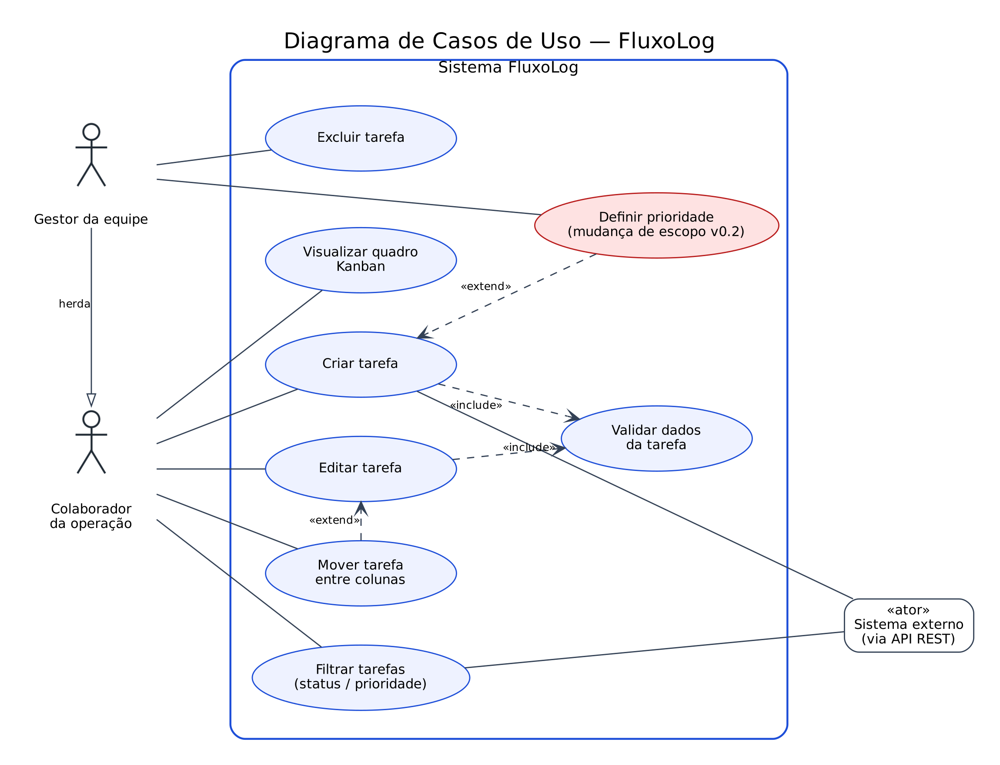
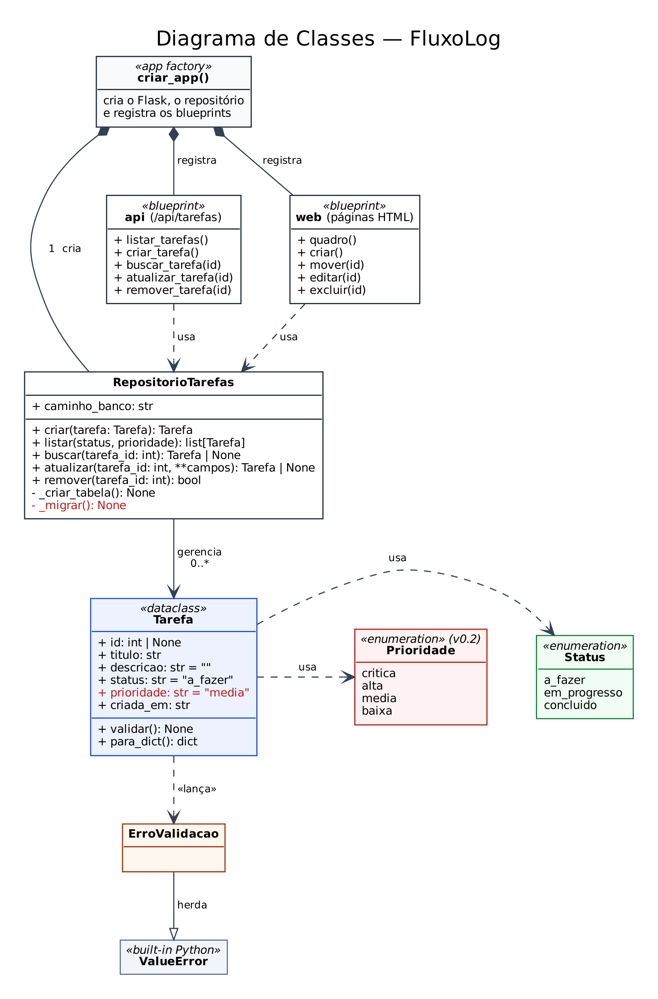

# Documentação do FluxoLog

## Diagramas UML (`/docs/uml`)

| Diagrama | Imagem | Fonte (Graphviz) |
|---|---|---|
| Casos de Uso | [casos-de-uso.png](uml/casos-de-uso.png) | [casos_de_uso.dot](uml/casos_de_uso.dot) |
| Classes | [classes.png](uml/classes.png) | [classes.dot](uml/classes.dot) |

Elementos em **vermelho** nos diagramas foram adicionados pela mudança de escopo v0.2
(prioridade das tarefas).

Para gerar as imagens de novo (precisa do [Graphviz](https://graphviz.org/) instalado):

```bash
cd docs/uml
neato -Tpng -Gdpi=200 casos_de_uso.dot -o casos-de-uso.png
dot   -Tpng -Gdpi=200 classes.dot      -o classes.png
```




